<div align="center">
  <a href="https://cuentalibre.es">
    
  </a>

  <h3 align="center">cuentalibre</h3>

  <p align="center">
    Facturas, gastos e impuestos para autónomos en España, de código abierto.
    <br />
    Privado por defecto, gratis en tu servidor y auditable hasta la última casilla del IVA.
    <br />
    <br />
    <a href="https://cuentalibre.es">Web</a>
    ·
    <a href="https://app.cuentalibre.es/demo"><strong>Probar la demo</strong></a>
    ·
    <a href="https://cuentalibre.es/docs">Documentación</a>
    ·
    <a href="https://cuentalibre.es/docs/api">API</a>
    ·
    <a href="#úsalo-con-tu-agente-de-ia">Agentes de IA</a>
    ·
    <a href="https://cuentalibre.es/docs/instalar">Instalar en tu servidor</a>
  </p>

  <p align="center"><a href="README.md">English</a> · <b>Español</b></p>
</div>

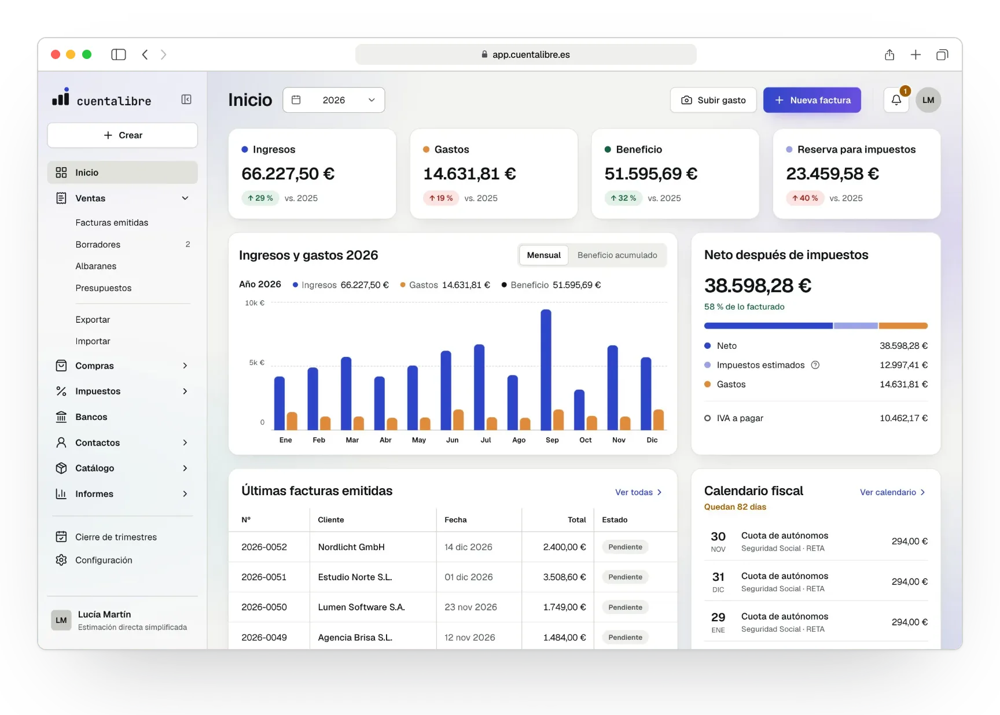

<table>
  <tr>
    <td width="50%" valign="top">
      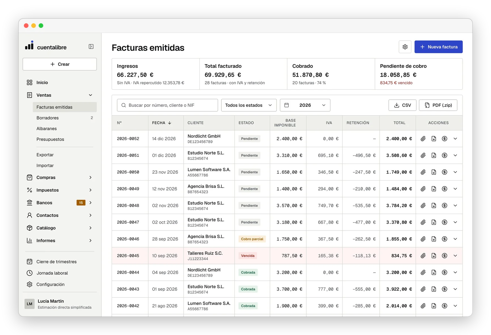
      <p align="center"><b>Facturas</b>: estado de cobro, IVA y retención de un vistazo.</p>
    </td>
    <td width="50%" valign="top">
      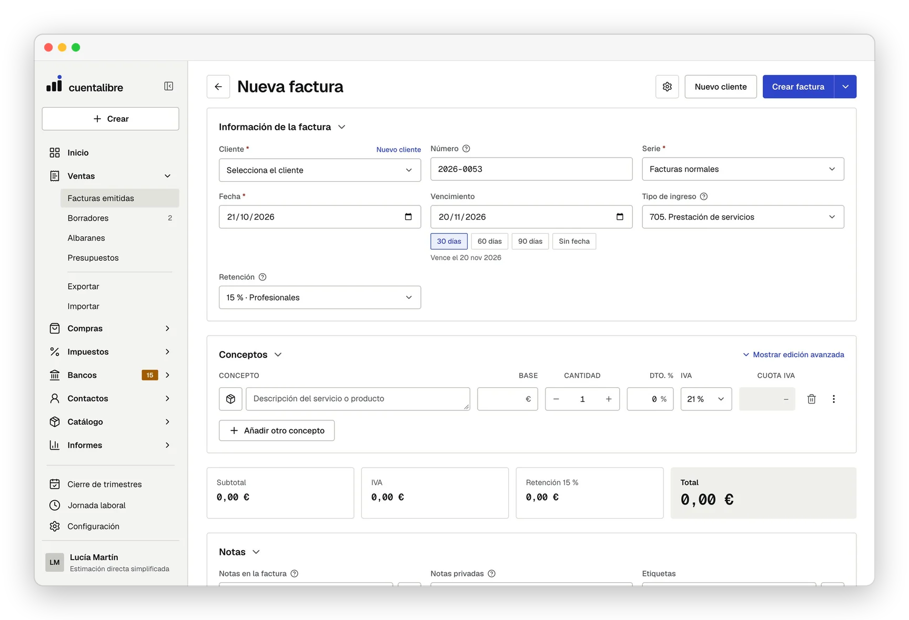
      <p align="center"><b>Editor de facturas</b>: numeración correlativa y PDF en un minuto.</p>
    </td>
  </tr>
  <tr>
    <td valign="top">
      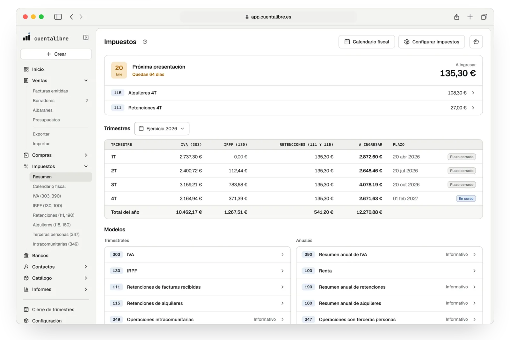
      <p align="center"><b>Impuestos</b>: lo que sale a pagar en cada trimestre y el próximo plazo.</p>
    </td>
    <td valign="top">
      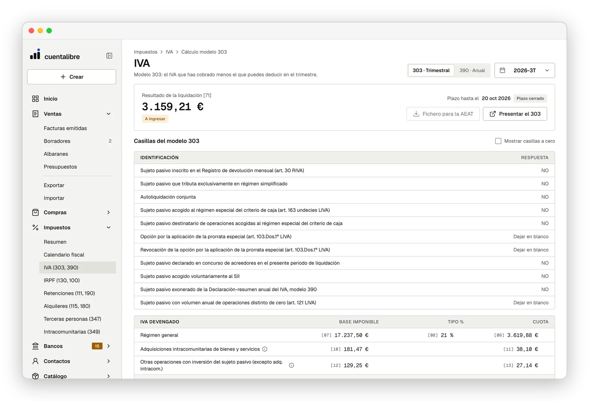
      <p align="center"><b>Modelo 303</b>: el IVA casilla a casilla, calculado con tus documentos.</p>
    </td>
  </tr>
  <tr>
    <td valign="top">
      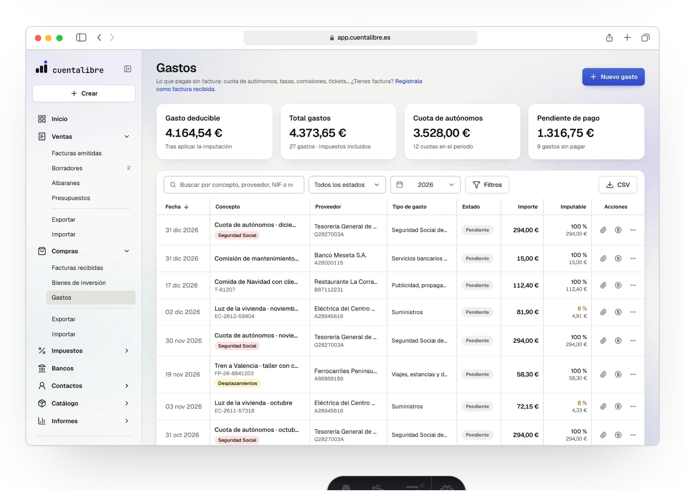
      <p align="center"><b>Gastos</b>: cuota de autónomos, tickets y facturas recibidas con su justificante.</p>
    </td>
    <td valign="top">
      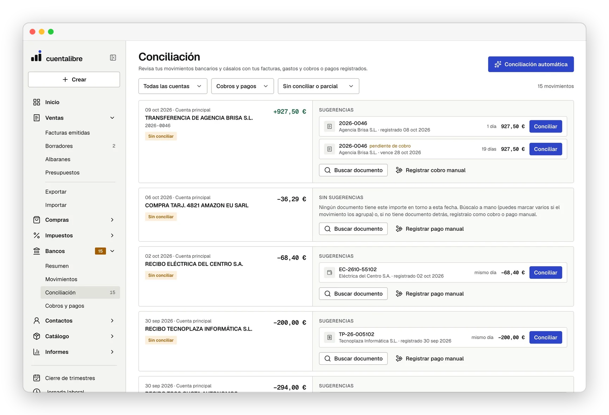
      <p align="center"><b>Bancos</b>: lo que cobras y pagas cada mes, y por qué cuenta pasa.</p>
    </td>
  </tr>
  <tr>
    <td valign="top">
      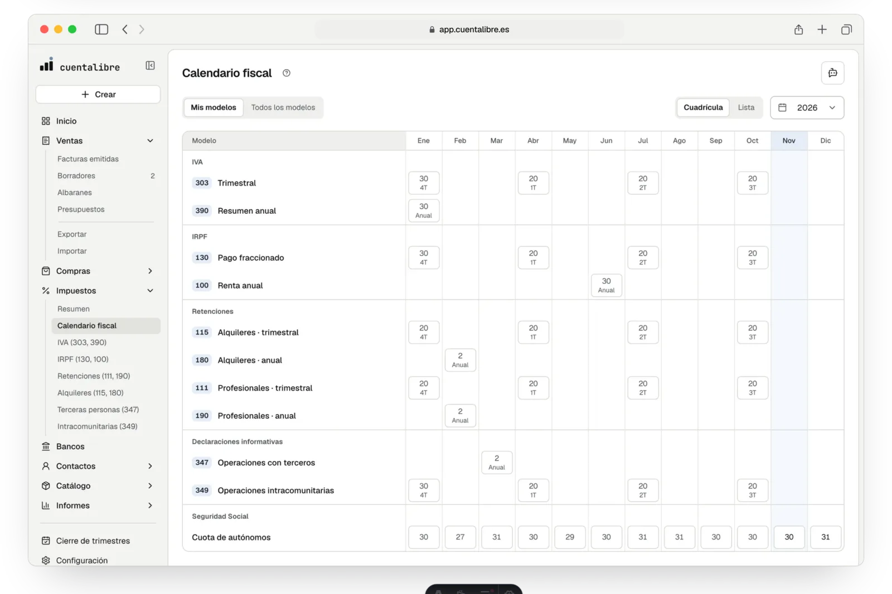
      <p align="center"><b>Calendario fiscal</b>: solo los modelos que te afectan, con su importe.</p>
    </td>
    <td valign="top">
      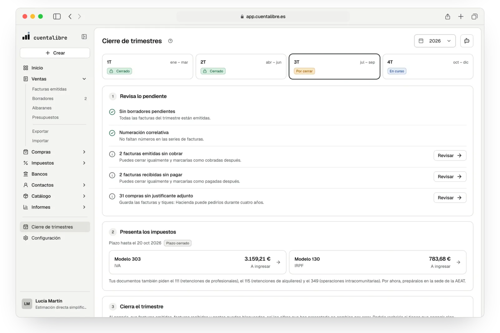
      <p align="center"><b>Cierre de trimestre</b>: lo que queda pendiente antes de presentar.</p>
    </td>
  </tr>
  <tr>
    <td valign="top">
      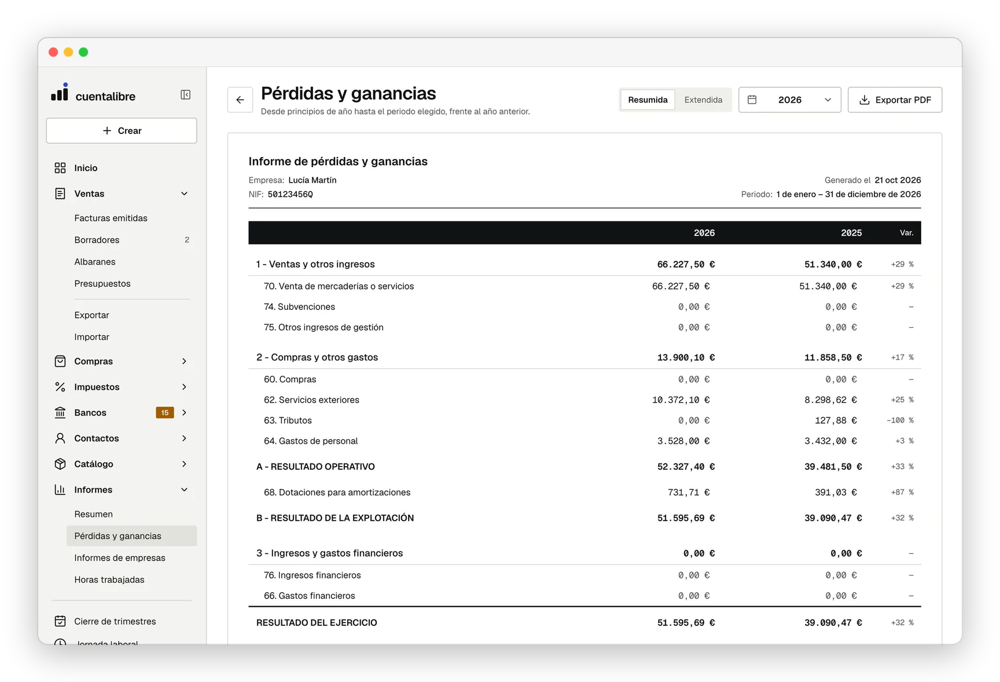
      <p align="center"><b>Pérdidas y ganancias</b>: tu año frente al anterior, exportable a PDF.</p>
    </td>
  </tr>
</table>

<p align="center">
  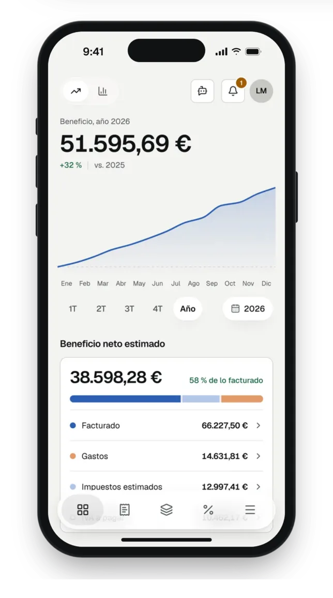
  &nbsp;
  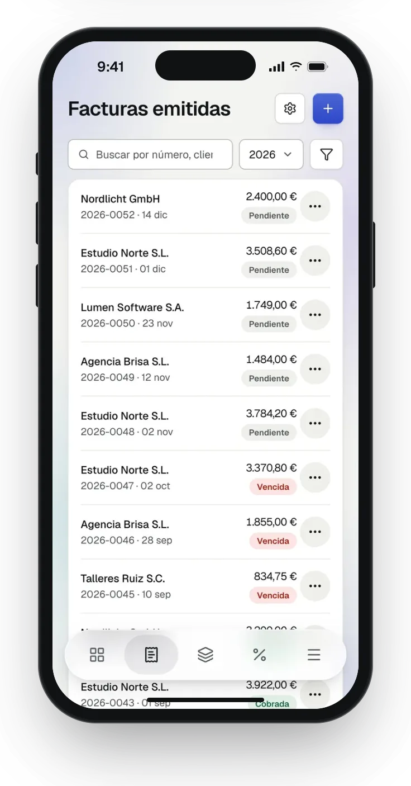
  &nbsp;
  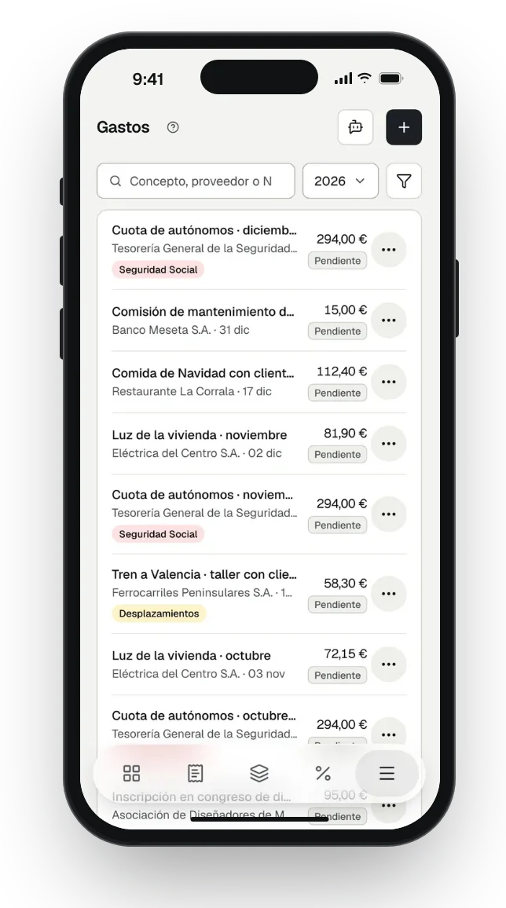
  &nbsp;
  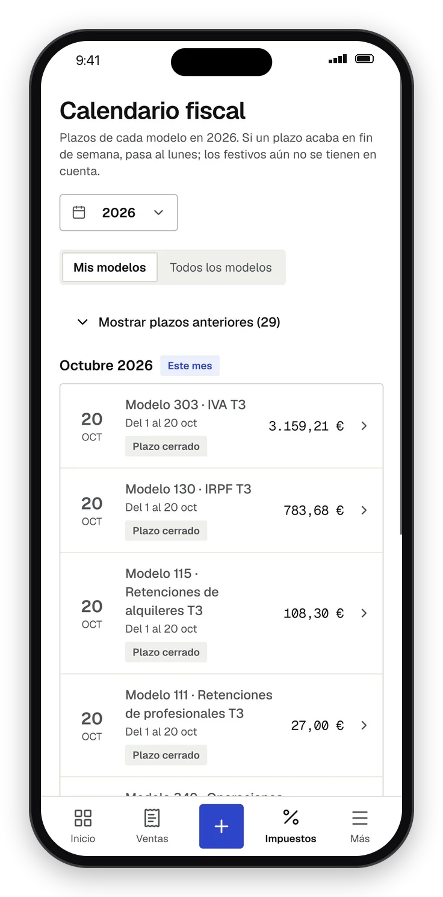
  <br />
  <em>Y todo, también en el móvil.</em>
</p>

## Qué es

**cuentalibre** lleva la contabilidad de un autónomo en España: facturas, presupuestos y albaranes, gastos y facturas recibidas, bancos y los modelos trimestrales que salen de todo ello. Cada cálculo de IVA e IRPF es código abierto: puedes revisarlo, auditarlo y mejorarlo.

Puedes usarlo de dos formas:

- **En tu propio servidor**, gratis para siempre ([guía](https://cuentalibre.es/docs/instalar)).
- **cuentalibre online**, en [app.cuentalibre.es](https://app.cuentalibre.es), si prefieres no ocuparte de un servidor.

### Funcionalidades

- **🧾 Facturas ilimitadas**: facturas, presupuestos y albaranes, con numeración correlativa, series propias, rectificativas y PDF.
- **💸 Gastos deducibles**: cuota de autónomos, tickets y facturas recibidas con su justificante, y bienes de inversión con su amortización.
- **📊 IVA e IRPF casilla a casilla**: los modelos 303, 130 y 390 calculados con tus documentos, para revisarlos y presentarlos en la AEAT.
- **📅 Calendario fiscal**: cada plazo que te afecta, con el importe antes de que llegue.
- **🏦 Cobros y pagos**: cada cobro y pago de tus facturas y gastos, con la cuenta por la que pasó.
- **🔒 Cierre de trimestre**: una lista de lo pendiente antes de presentar; después, los libros del trimestre quedan congelados.
- **📈 Informes**: pérdidas y ganancias, tu año frente al anterior.
- **🤖 API y agentes**: una API REST pública con claves, un [documento OpenAPI](https://api.cuentalibre.es/v1/openapi.json) y una skill lista para que tu agente de IA registre gastos o prepare facturas por ti ([más abajo](#úsalo-con-tu-agente-de-ia)).
- **📱 En cualquier dispositivo**: una aplicación web rápida, pensada para el ordenador y el móvil.

## Ponerlo en marcha en local

> [!NOTE]
> **¿Solo quieres usar cuentalibre?** Sigue la [guía de instalación](https://cuentalibre.es/docs/instalar) para tenerlo en tu servidor, o regístrate en [app.cuentalibre.es](https://app.cuentalibre.es). El resto de este README es para quien trabaja en su código.

### Requisitos

- [Node.js](https://nodejs.org) 22 o posterior.
- [pnpm](https://pnpm.io) 12 (`corepack enable` usa la versión de `package.json`).
- [Docker](https://docs.docker.com/get-docker/), para la base de datos de desarrollo (o tu propio PostgreSQL 18).

### 1. Instala

```sh
git clone https://github.com/jesuspb2/cuentalibre.git
cd cuentalibre
pnpm install
```

### 2. Arranca la base de datos y migra

```sh
docker compose up -d                          # PostgreSQL en localhost:5432 (usuario, contraseña y base de datos: cuentalibre)
pnpm --filter @cuentalibre/api db:migrate     # crea las tablas
```

### 3. Conecta la aplicación web con la API

Crea `apps/web/.env.local`:

```sh
VITE_API_URL=http://localhost:3000
VITE_SITE_URL=http://localhost:4321
```

Sin `VITE_API_URL`, la aplicación web solo abre la demo, con datos de ejemplo. `VITE_API_URL=/` quiere decir que la API sirve la aplicación desde su mismo origen, como hace la imagen para instalarlo en tu servidor.

La API y la web pública funcionan sin configurar nada: cada ajuste tiene un valor por defecto para desarrollo. Para cambiar alguno, copia `apps/api/.env.example` a `apps/api/.env` (o `apps/site/.env.example` a `apps/site/.env`).

### 4. Arráncalo todo

```sh
pnpm dev
```

| Qué                         | URL                                                                         |
| --------------------------- | --------------------------------------------------------------------------- |
| Aplicación web              | http://localhost:5173                                                       |
| API                         | http://localhost:3000/v1 ([OpenAPI](http://localhost:3000/v1/openapi.json)) |
| Web pública y documentación | http://localhost:4321                                                       |

Abre http://localhost:5173/registro para crear tu cuenta y tu empresa, o http://localhost:5173/demo para probarlo con datos de ejemplo y sin cuenta. Registrarse no necesita servidor de correo; los correos de verificación solo se envían cuando configuras SMTP.

Para arrancar una sola aplicación: `pnpm --filter @cuentalibre/web dev` (o `api`, `site`).

### Servicios opcionales

Todos vienen desactivados y se configuran en `apps/api/.env`; [`.env.example`](apps/api/.env.example) explica cada uno.

| Qué                                                              | Variables                                                                           |
| ---------------------------------------------------------------- | ----------------------------------------------------------------------------------- |
| Entrar con Google                                                | `GOOGLE_CLIENT_ID`, `GOOGLE_CLIENT_SECRET`                                          |
| Enviar correos (facturas, verificación, recuperar la contraseña) | `SMTP_URL`, `EMAIL_FROM`, `ACCOUNT_EMAIL_FROM`                                      |
| Archivos en un bucket compatible con S3 en vez del disco         | `STORAGE_DRIVER=s3`, `S3_*`                                                         |
| Enviar los errores inesperados a Sentry                          | `SENTRY_DSN`                                                                        |
| Leer facturas recibidas y tickets con IA                         | `AI_SCAN_MODEL`, `AI_SCAN_API_KEY`, `AI_SCAN_BASE_URL`, `AI_SCAN_MONTHLY_DOCUMENTS` |
| Chat de ayuda sobre el uso de la app, respondido por IA          | `AI_CHAT_MODEL`, `AI_CHAT_API_KEY`, `AI_CHAT_BASE_URL`, `AI_CHAT_DAILY_QUESTIONS`   |

### Comprobaciones

```sh
pnpm typecheck
pnpm test      # los tests de integración de la API necesitan la base de datos de compose
pnpm build
pnpm format    # Prettier
```

## Úsalo con tu agente de IA

La API de cuentalibre es la misma que usa la aplicación, así que un agente de IA (Claude Code, Codex, un GPT de ChatGPT, n8n…) puede hacer todo lo que haces tú, con las mismas reglas: numeración correlativa y trimestres cerrados. El repositorio incluye una skill que le enseña al agente toda la API y cuándo debe pararse a preguntarte.

### 1. Crea una clave

En la aplicación, ve a **Configuración › API y agentes** y crea una clave para el agente. Empieza por `fsk_` y solo se muestra una vez. Pásasela al agente en el entorno, nunca en el chat:

```sh
export CUENTALIBRE_API_KEY="fsk_…"
export CUENTALIBRE_API_URL="http://localhost:3000/v1"   # solo en local o en tu servidor; por defecto, https://api.cuentalibre.es/v1
```

### 2. Dale la skill a tu agente

La skill está en [`.agents/skills/cuentalibre`](.agents/skills/cuentalibre): `SKILL.md` con las reglas y los flujos de trabajo, `references/` con cada ruta y cada campo, y `scripts/cuentalibre.sh`, un envoltorio de `curl` que añade la clave.

- **Dentro de este repositorio** ya está disponible: Claude Code la carga desde [`.claude/skills/cuentalibre`](.claude/skills/cuentalibre) (un enlace a la misma carpeta), y los agentes que leen `.agents/skills` la encuentran ahí.
- **En cualquier otro sitio**, enlaza o copia la carpeta en el directorio de skills de tu agente. En Claude Code, para todos tus proyectos:

  ```sh
  ln -s "$PWD/.agents/skills/cuentalibre" ~/.claude/skills/cuentalibre
  ```

Los agentes sin skills pueden leer toda la referencia en un solo archivo Markdown, [`cuentalibre.es/docs/api.md`](https://cuentalibre.es/docs/api.md), o importar el [documento OpenAPI](https://api.cuentalibre.es/v1/openapi.json) como acciones. La [guía de agentes](https://cuentalibre.es/docs/agentes) explica cómo configurarlo en cada tipo de herramienta.

### 3. Pídeselo

Háblale como a tu gestor:

- _«Registra este ticket como gasto: ~/Descargas/ticket-gasolinera.pdf»_
- _«Contabiliza esta factura de proveedor y adjunta el PDF.»_
- _«Prepara la factura de octubre para Estudio Norte, igual que la de septiembre, y enséñamela antes de emitirla.»_
- _«¿Qué clientes me deben dinero, y desde cuándo?»_
- _«¿Cuánto IVA llevo este trimestre?»_

Con la skill, el agente te enseña lo que va a enviar y espera tu confirmación antes de cualquier cosa que no se pueda deshacer: emitir una factura, borrar, enviar un correo, cambiar los ajustes o cerrar un trimestre. Sus cambios aparecen en la aplicación al momento. Cuando acabes, revoca la clave en la misma página de ajustes.

## Estructura del proyecto

Workspaces de pnpm con [Turborepo](https://turborepo.com):

```
apps/web               La aplicación (Vite + React + TypeScript + Tailwind CSS v4)
apps/api               El backend (Hono + Drizzle + PostgreSQL, Better Auth)
apps/site              Web pública y documentación (Astro, estática)
packages/core          Lógica de dominio compartida por front y back: periodos, cálculo de impuestos, calendario fiscal
packages/contracts     Esquemas zod de los datos guardados; los tipos se infieren de ellos
packages/ui            Sistema de diseño: tokens, estilos base y componentes
deploy/                Cómo funciona cuentalibre online, para quien lo mantiene: Caddy, la API y PostgreSQL en un servidor
selfhost/              Para instalarlo en tu servidor: una imagen con la aplicación y la API, más PostgreSQL
.agents/skills/        La skill de cuentalibre para agentes de IA (.claude/skills enlaza a ella)
```

Más en [apps/api/README.md](apps/api/README.md) (rutas, sincronización, cómo se construyen las imágenes, en inglés), en [deploy/README.md](deploy/README.md) (cómo se opera cuentalibre online, en inglés) y en [AGENTS.md](AGENTS.md) (convenciones para quien contribuye y para agentes de programación).

La página de referencia del sistema de diseño de la aplicación está en `/sistema-visual`.

### Tokens de diseño

Los tokens están en `packages/ui/src/styles/`, en tres capas:

1. `primitives.css`: la paleta en bruto (`--neutral-200`, `--blue-600`…). Los componentes nunca la usan directamente.
2. `semantic.css`: tokens por función (`--primary`, `--muted-foreground`, `--border`…), con valores para modo claro y oscuro (`.dark`).
3. `theme.css`: los expone a Tailwind (`bg-primary`, `text-muted-foreground`, `rounded-xl`, `text-2xs`…). Las escalas por defecto de colores, tamaños de letra y radios de Tailwind están desactivadas.

Los nombres siguen las convenciones de shadcn/ui. Ojo: `accent` es la superficie al pasar el ratón; el color de marca es `primary`. Para importes, usa la clase `amount` (Geist Mono con cifras tabulares) y `formatEUR()` de `@cuentalibre/ui/lib/format`.

## Contribuir

Los issues y los pull requests son bienvenidos. Lee antes [CONTRIBUTING.es.md](CONTRIBUTING.es.md): cómo avisar de errores y de reglas fiscales mal aplicadas, preparar el entorno y abrir un pull request.

## Licencia

[AGPL-3.0](LICENSE). cuentalibre se ofrece tal cual, sin ninguna garantía, y no es asesoramiento fiscal: revisa las cifras antes de presentar.
