<div align="center">
  <a href="https://cuentalibre.es">
    
  </a>

  <h3 align="center">cuentalibre</h3>

  <p align="center">
    Open-source invoicing, expenses and taxes for self-employed workers (<em>autónomos</em>) in Spain.
    <br />
    Private by default, free to self-host, auditable down to every VAT box.
    <br />
    <br />
    <a href="https://cuentalibre.es">Website</a>
    ·
    <a href="https://app.cuentalibre.es/demo"><strong>Try the demo</strong></a>
    ·
    <a href="https://cuentalibre.es/docs">Docs</a>
    ·
    <a href="https://cuentalibre.es/docs/api">API</a>
    ·
    <a href="#use-it-with-your-ai-agent">AI agents</a>
    ·
    <a href="https://cuentalibre.es/docs/instalar">Self-hosting</a>
  </p>

  <p align="center"><b>English</b> · <a href="README.es.md">Español</a></p>
</div>

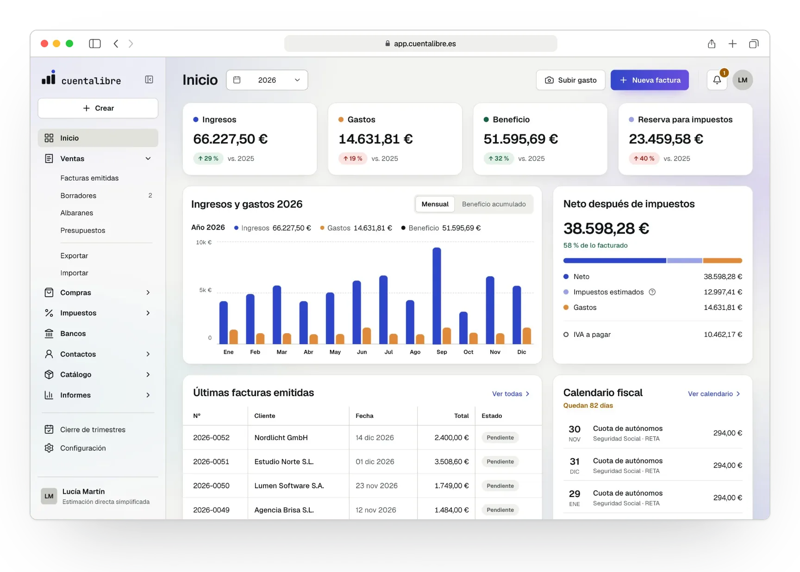

<table>
  <tr>
    <td width="50%" valign="top">
      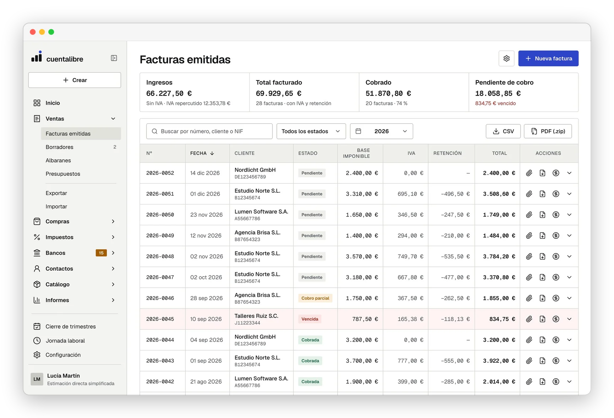
      <p align="center"><b>Invoices</b>: collection status, VAT and withholding at a glance.</p>
    </td>
    <td width="50%" valign="top">
      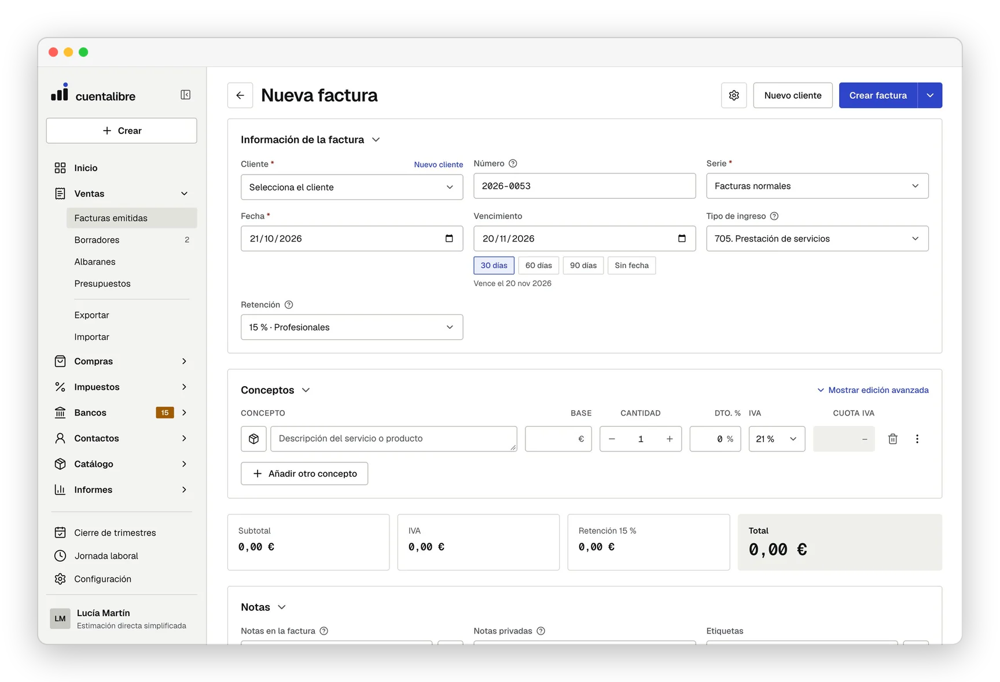
      <p align="center"><b>Invoice editor</b>: gapless numbering and a PDF in a minute.</p>
    </td>
  </tr>
  <tr>
    <td valign="top">
      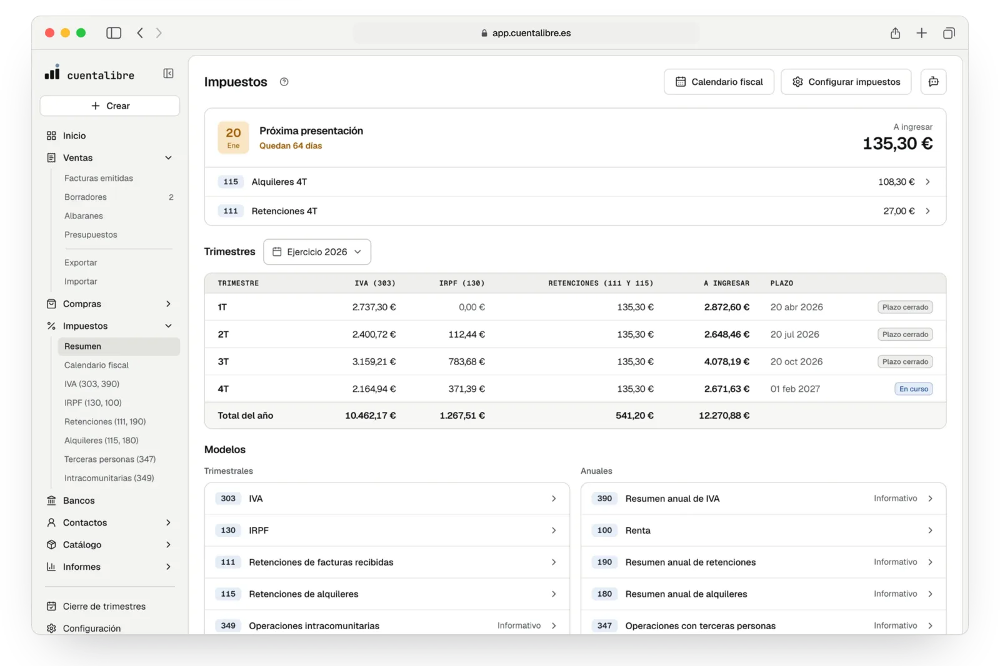
      <p align="center"><b>Taxes</b>: what each quarter owes and the next deadline.</p>
    </td>
    <td valign="top">
      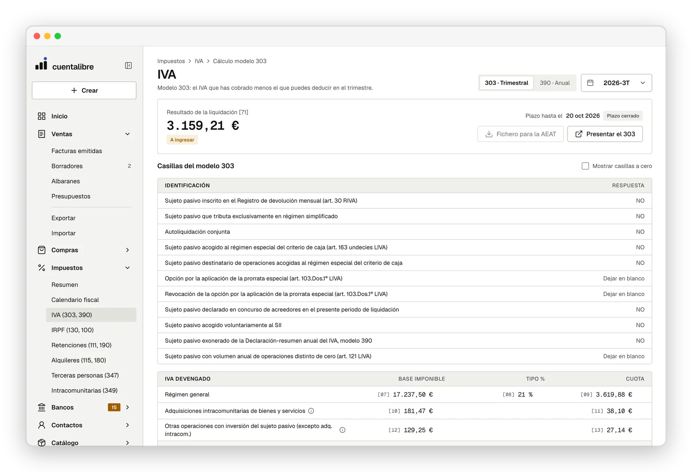
      <p align="center"><b>Form 303</b>: VAT box by box, computed from your documents.</p>
    </td>
  </tr>
  <tr>
    <td valign="top">
      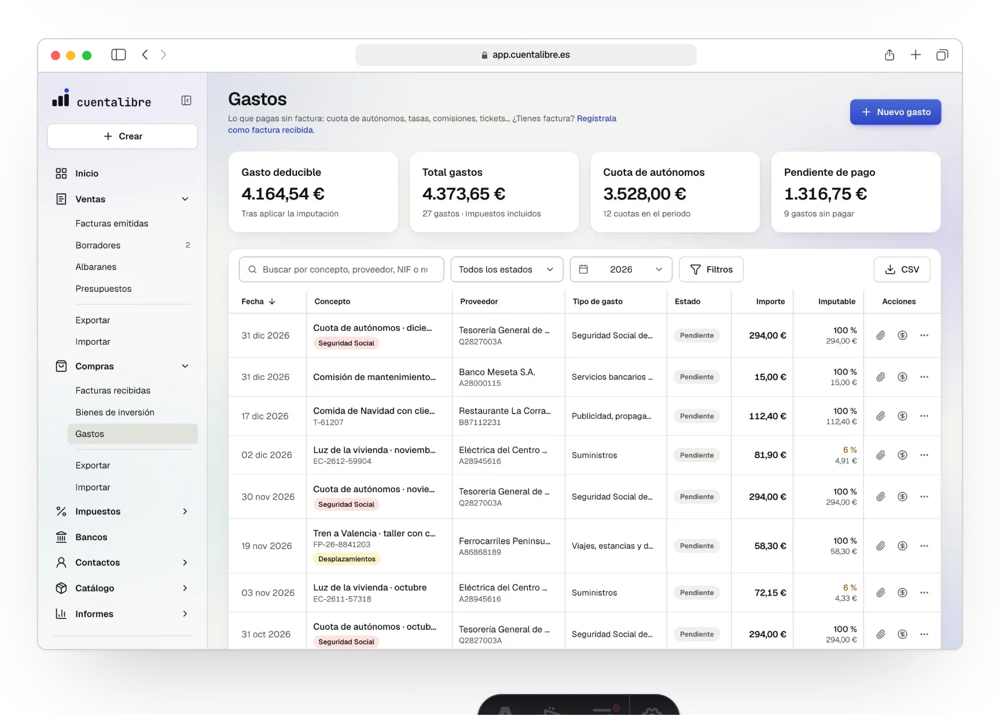
      <p align="center"><b>Expenses</b>: the autónomo fee, tickets and received invoices with their receipts.</p>
    </td>
    <td valign="top">
      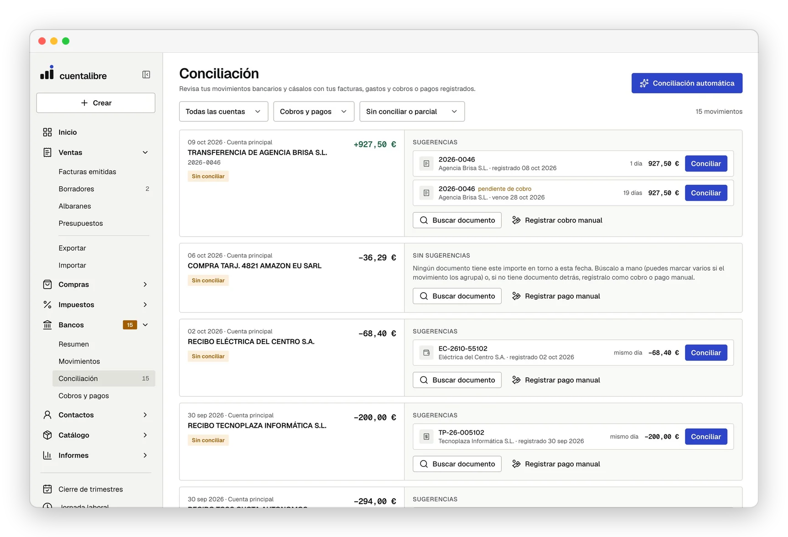
      <p align="center"><b>Banks</b>: what you collect and pay each month, and through which account.</p>
    </td>
  </tr>
  <tr>
    <td valign="top">
      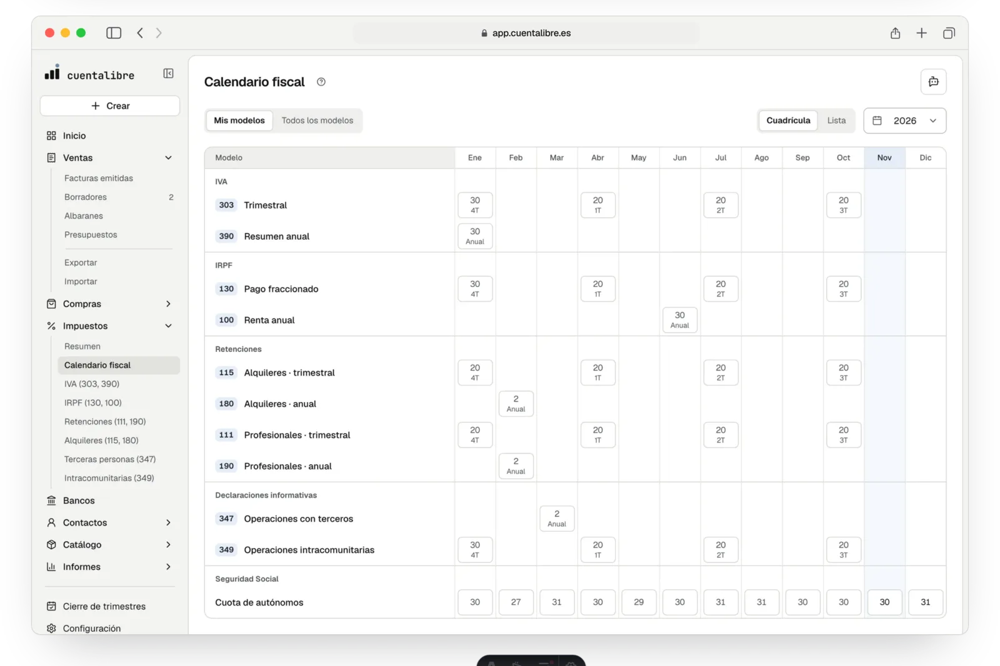
      <p align="center"><b>Filing calendar</b>: only the forms that apply to you, with their amounts.</p>
    </td>
    <td valign="top">
      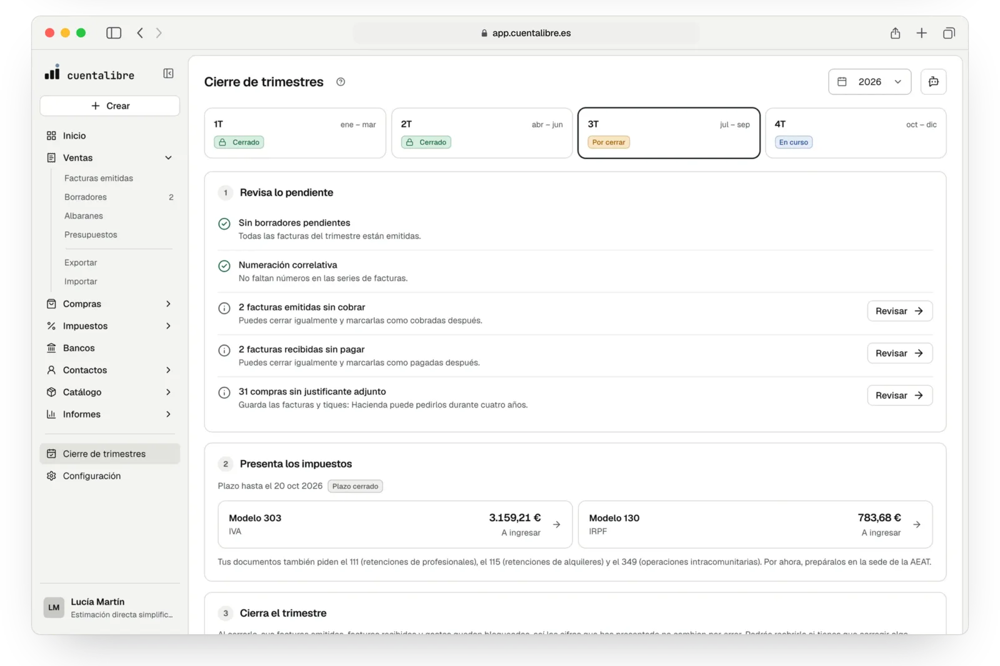
      <p align="center"><b>Quarter closing</b>: a checklist of what's pending before you file.</p>
    </td>
  </tr>
  <tr>
    <td valign="top">
      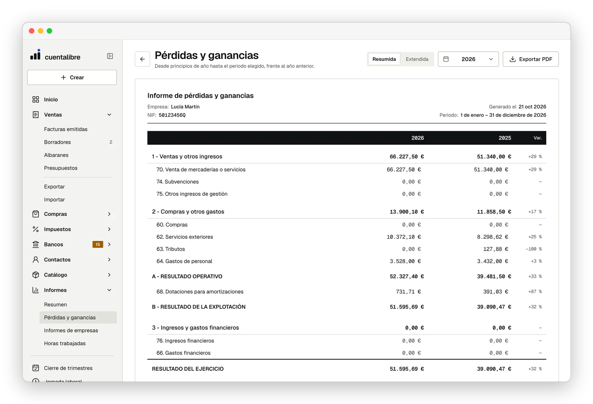
      <p align="center"><b>Profit and loss</b>: this year against the last, exportable to PDF.</p>
    </td>
  </tr>
</table>

<p align="center">
  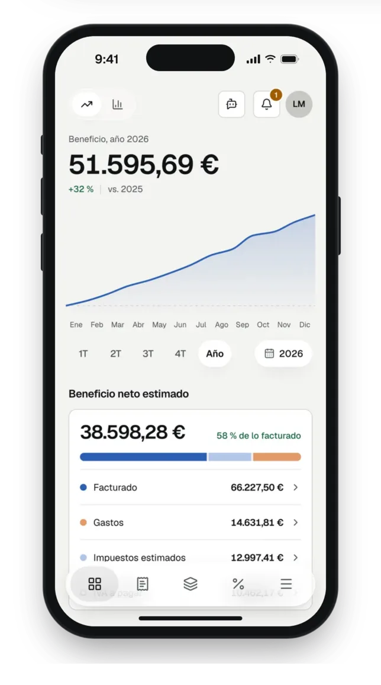
  &nbsp;
  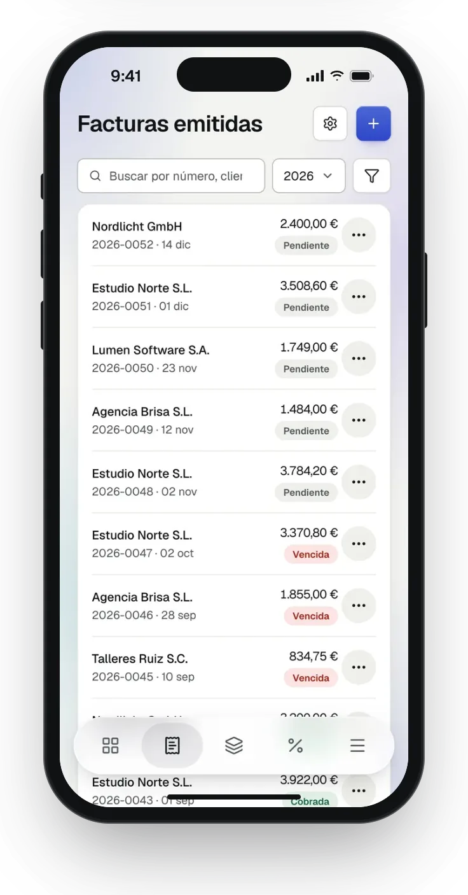
  &nbsp;
  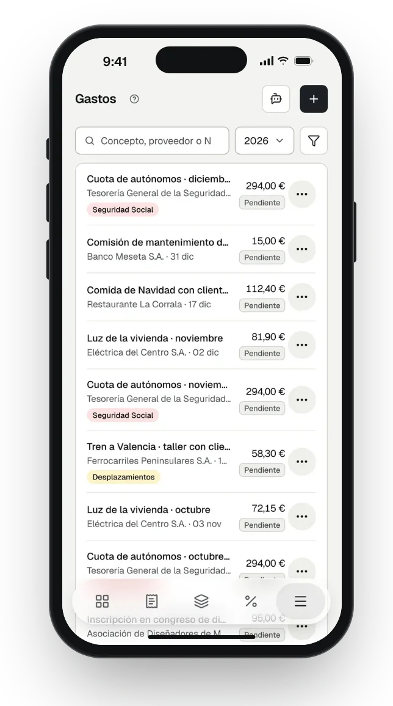
  &nbsp;
  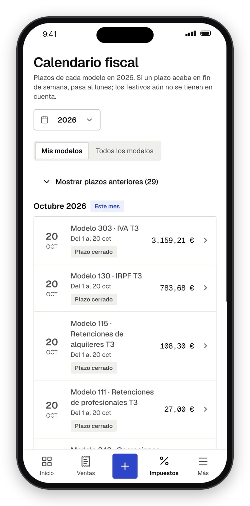
  <br />
  <em>And all of it on your phone.</em>
</p>

## Introduction

**cuentalibre** keeps the books of a Spanish self-employed worker: invoices, quotes and delivery notes, expenses and received invoices, banks, and the quarterly returns that come out of them. Every VAT and IRPF calculation is open source, so it can be reviewed, audited and improved.

Use it two ways:

- **Self-hosted**, free forever: run it on your own server ([guide](https://cuentalibre.es/docs/instalar)).
- **cuentalibre online** at [app.cuentalibre.es](https://app.cuentalibre.es), if you'd rather not run a server.

The UI is in Spanish, like the taxes it deals with.

### Features

- **🧾 Unlimited invoicing**: invoices, quotes and delivery notes, with gapless numbering, custom series, rectifying invoices and PDFs.
- **💸 Deductible expenses**: the autónomo fee, tickets and received invoices with their receipts attached, and investment goods with their amortization.
- **📊 VAT and IRPF, box by box**: forms 303, 130 and 390 computed from your documents, to review and file with the AEAT.
- **📅 Filing calendar**: every deadline that applies to you, with the amount before it arrives.
- **🏦 Collections and payments**: every collection and payment of your invoices and expenses, with the account it went through.
- **🔒 Quarter closing**: a checklist before filing, after which the quarter's books are frozen.
- **📈 Reports**: profit and loss, this year against the last.
- **🤖 API and agents**: a public REST API with API keys, an [OpenAPI document](https://api.cuentalibre.es/v1/openapi.json) and a ready-made skill so your AI agent can book expenses or prepare invoices for you ([see below](#use-it-with-your-ai-agent)).
- **📱 Works on any device**: a fast web app, designed for the desktop and the phone.

## Running it locally

> [!NOTE]
> **Just want to use cuentalibre?** Follow the [self-hosting guide](https://cuentalibre.es/docs/instalar) to run it on your own server, or sign up at [app.cuentalibre.es](https://app.cuentalibre.es). The rest of this README is for people who work on its code.

### Requirements

- [Node.js](https://nodejs.org) 26 or newer.
- [pnpm](https://pnpm.io) 12 (`corepack enable` picks the version from `package.json`).
- [Docker](https://docs.docker.com/get-docker/), for the development database (or your own PostgreSQL 18).

### 1. Install

```sh
git clone https://github.com/cuentalibre-app/cuentalibre.git
cd cuentalibre
pnpm install
```

### 2. Start the database and migrate it

```sh
docker compose up -d                          # PostgreSQL on localhost:5432 (user, password and db: cuentalibre)
pnpm --filter @cuentalibre/api db:migrate     # creates the tables
```

### 3. Point the web app at the API

Create `apps/web/.env.local`:

```sh
VITE_API_URL=http://localhost:3000
VITE_SITE_URL=http://localhost:4321
```

Without `VITE_API_URL` the web app only runs the demo, on sample data. `VITE_API_URL=/` means the API serves the app from its own origin, as the self-hosting image does.

The API and the site work without any configuration: every setting has a development default. To change one, copy `apps/api/.env.example` to `apps/api/.env` (or `apps/site/.env.example` to `apps/site/.env`).

### 4. Run everything

```sh
pnpm dev
```

| What                 | URL                                                                         |
| -------------------- | --------------------------------------------------------------------------- |
| Web app              | http://localhost:5173                                                       |
| API                  | http://localhost:3000/v1 ([OpenAPI](http://localhost:3000/v1/openapi.json)) |
| Public site and docs | http://localhost:4321                                                       |

Open http://localhost:5173/registro to create an account and your business, or http://localhost:5173/demo to explore with sample data and no account. Signing up needs no email server; verification emails are only sent once SMTP is set up.

To run a single app: `pnpm --filter @cuentalibre/web dev` (or `api`, `site`).

### Optional services

All of these are off by default and set in `apps/api/.env`; [`.env.example`](apps/api/.env.example) documents each one.

| Feature                                                | Variables                                      |
| ------------------------------------------------------ | ---------------------------------------------- |
| Sign in with Google                                    | `GOOGLE_CLIENT_ID`, `GOOGLE_CLIENT_SECRET`     |
| Sending email (invoices, verification, password reset) | `SMTP_URL`, `EMAIL_FROM`, `ACCOUNT_EMAIL_FROM` |
| Files in an S3-compatible bucket instead of local disk | `STORAGE_DRIVER=s3`, `S3_*`                    |
| Reporting unexpected errors to Sentry                  | `SENTRY_DSN`                                   |

### Checks

```sh
pnpm typecheck
pnpm test      # the API's integration tests need the compose database running
pnpm build
pnpm format    # Prettier
```

## Use it with your AI agent

cuentalibre's API is the one the app uses, so an AI agent (Claude Code, Codex, a ChatGPT GPT, n8n…) can do anything you can, under the same rules: gapless numbering and closed quarters. The repository ships a skill that teaches agents the whole API and when to stop and ask you.

### 1. Create a key

In the app, open **Configuración › API y agentes** and create a key for the agent. It starts with `fsk_` and is shown once. Give it to the agent through the environment, never in the chat:

```sh
export CUENTALIBRE_API_KEY="fsk_…"
export CUENTALIBRE_API_URL="http://localhost:3000/v1"   # only for a local or self-hosted instance; defaults to https://api.cuentalibre.es/v1
```

### 2. Give your agent the skill

The skill lives in [`.agents/skills/cuentalibre`](.agents/skills/cuentalibre): `SKILL.md` with the rules and workflows, `references/` with every route and field, and `scripts/cuentalibre.sh`, a `curl` wrapper that adds the key.

- **Inside this repository** it's already there: Claude Code loads it from [`.claude/skills/cuentalibre`](.claude/skills/cuentalibre) (a link to the same folder), and agents that read `.agents/skills` load it from there.
- **Anywhere else**, link or copy the folder into your agent's skills directory. For Claude Code, for every project:

  ```sh
  ln -s "$PWD/.agents/skills/cuentalibre" ~/.claude/skills/cuentalibre
  ```

Agents without skills can read the whole reference as one Markdown file, [`cuentalibre.es/docs/api.md`](https://cuentalibre.es/docs/api.md), or import the [OpenAPI document](https://api.cuentalibre.es/v1/openapi.json) as actions. The [agent guide](https://cuentalibre.es/docs/agentes) has the setup for each kind of tool.

### 3. Ask

Talk to it as you would to your gestor, in Spanish or English:

- _"Registra este ticket como gasto: ~/Descargas/ticket-gasolinera.pdf"_
- _"Book this supplier invoice and attach the PDF."_
- _"Prepara la factura de octubre para Estudio Norte, igual que la de septiembre, y enséñamela antes de emitirla."_
- _"Which clients owe me money, and since when?"_
- _"¿Cuánto IVA llevo este trimestre?"_

The skill has the agent show you what it's about to send and wait for your yes before anything that can't be undone: issuing an invoice, deleting, sending an email, changing settings or closing a quarter. Its changes show up in the app at once. Revoke the key in the same settings page when you're done.

## Project structure

pnpm workspaces with [Turborepo](https://turborepo.com):

```
apps/web               The app (Vite + React + TypeScript + Tailwind CSS v4)
apps/api               The backend (Hono + Drizzle + PostgreSQL, Better Auth)
apps/site              Public site and documentation (Astro, static)
packages/core          Domain logic shared by front and back: periods, tax calculations, filing calendar
packages/contracts     zod schemas of the stored data; types are inferred from them
packages/ui            Design system: tokens, base styles and components
deploy/                How cuentalibre online runs, for its maintainers: Caddy, the API and PostgreSQL on one server
selfhost/              Self-hosting: one image with the app and the API, plus PostgreSQL
.agents/skills/        The cuentalibre skill for AI agents (.claude/skills links to it)
```

More in [apps/api/README.md](apps/api/README.md) (endpoints, sync, building the images), [deploy/README.md](deploy/README.md) (how cuentalibre online is operated) and [AGENTS.md](AGENTS.md) (conventions for contributors and coding agents).

The web app's design system reference page is at `/sistema-visual`.

### Design tokens

Tokens live in `packages/ui/src/styles/` in three layers:

1. `primitives.css`: the raw palette (`--neutral-200`, `--blue-600`…). Never used by components directly.
2. `semantic.css`: purpose-based tokens (`--primary`, `--muted-foreground`, `--border`…), with light and dark (`.dark`) values.
3. `theme.css`: exposes them to Tailwind (`bg-primary`, `text-muted-foreground`, `rounded-xl`, `text-2xs`…). Tailwind's default color, font-size and radius scales are disabled.

Names follow shadcn/ui conventions. Note that `accent` is the hover surface; the brand color is `primary`. For money amounts use the `amount` class (Geist Mono with tabular figures) and `formatEUR()` from `@cuentalibre/ui/lib/format`.

## Contributing

Issues and pull requests are welcome. Read [CONTRIBUTING.md](CONTRIBUTING.md) first: how to report bugs and tax rule errors, how to set up, and how to open a pull request.

## License

[AGPL-3.0](LICENSE). cuentalibre is provided as is, without any warranty, and is not tax advice: check the figures before you file.
